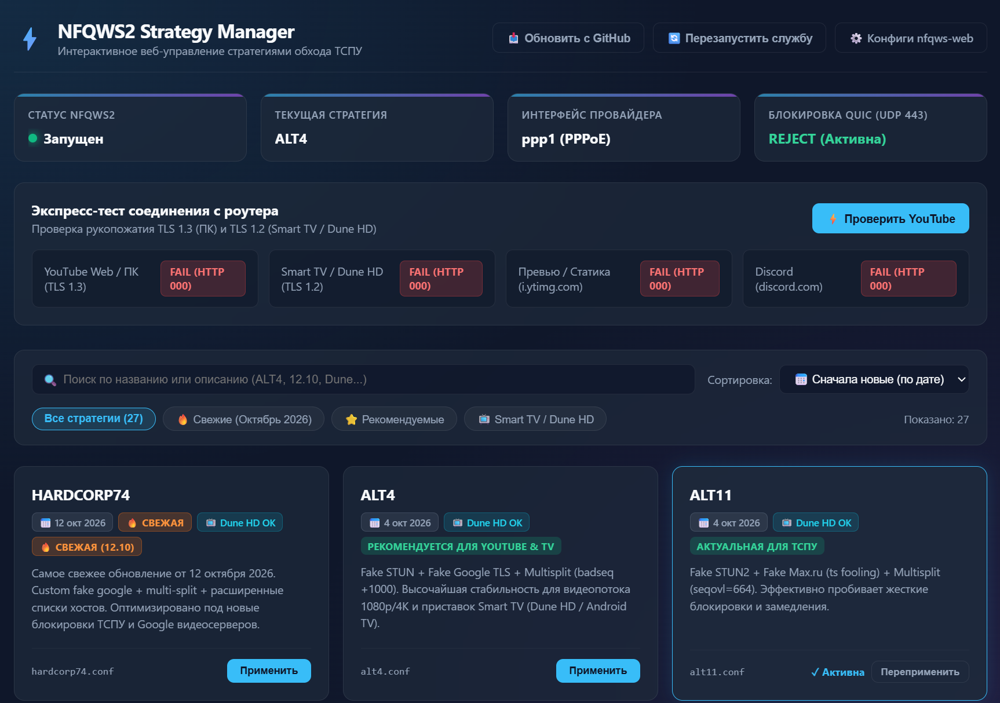
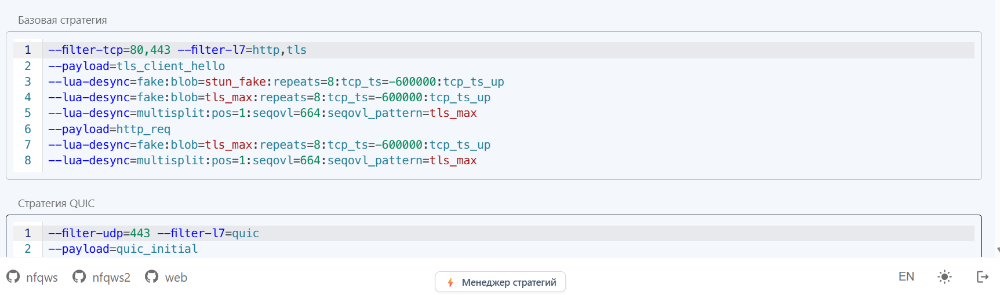

# Keenetic NFQWS2 Web Strategy Manager ⚡

Интерактивный веб-интерфейс (Web GUI) для роутеров **Keenetic** с установленной средой **Entware**. Позволяет в один клик переключать стратегии обхода ТСПУ (**NFQWS2 / Zapret**), проводить экспресс-диагностику доступности YouTube и Discord прямо из браузера, а также решает проблему зависания воспроизведения роликов через 1-2 минуты на приставках **Smart TV / Dune HD / Android TV**.

---

## 📸 Скриншоты интерфейса

### Основная панель управления и каталог стратегий:


### Интеграция кнопки в стандартную панель nfqws-web:


---

## ✨ Ключевые возможности

* **Переключение 27+ стратегий в один клик:** Больше не нужно каждый раз подключаться по SSH и вручную редактировать конфигурационные файлы — смена стратегии и перезапуск службы происходят за 1 секунду прямо из браузера.
* **Точные даты релизов и коммитов:** Каждая карточка стратегии снабжена датой актуальности (например, `📅 12 окт 2026` для `HARDCORP74`, `📅 4 окт 2026` для `ALT13`, `ALT11` и т.д.), что помогает сразу выбирать самые свежие решения под текущие блокировки ТСПУ.
* **Умная сортировка и мгновенный поиск:**
  * **Сортировка:** «Сначала новые (по дате)», «Рекомендуемые», «По имени (А-Я)», «Сначала старые».
  * **Быстрые теги-фильтры:** `🔥 Свежие (Октябрь 2026)`, `⭐ Рекомендуемые`, `📺 Smart TV / Dune HD` (профили с поддержкой TLS 1.2).
  * **Живой поиск:** фильтрация карточек на лету при вводе любого слова.
* **Встроенный экспресс-тест соединения с роутера:**
  * Тест рукопожатия **TLS 1.3** (ПК, современные браузеры и смартфоны).
  * Тест рукопожатия **TLS 1.2** (ТВ-приставки Dune HD, Smart TV, Android 7–9).
  * Проверка доступности картинок превью YouTube (`i.ytimg.com`).
  * Проверка шлюза Discord Web.
* **Готовая оптимизированная стратегия для Smart TV и региональных провайдеров (`dune_yarnet.conf`):**
  * Построена на базе `hostfakesplit` без жестких бинарных шаблонов TLS 1.3, благодаря чему стабильно работает как на старых ТВ-боксах с TLS 1.2, так и на ПК с TLS 1.3.
* **Скрипт сброса мертвых серверов Google Global Cache (`051-block-dead-ggc.sh`):**
  * Решает критическую проблему, когда видео стартует, но через 1-2 минуты наглухо зависает из-за деградировавших кэш-серверов провайдера.
* **Бесшовная интеграция:** В стандартную веб-панель `nfqws-web` (порт 90) аккуратно встраивается стильная кнопка `⚡ Менеджер стратегий` с поддержкой светлой и тёмной темы оформления.

---

## 🚀 Быстрая установка (в 1 команду)

Подключитесь к роутеру по SSH (`ssh root@192.168.1.1 -p 222`) и выполните команду:

```bash
sh -c "$(curl -fsSL https://raw.githubusercontent.com/YOUR_USERNAME/keenetic-nfqws2-manager/main/install.sh)"
```

После завершения установки откройте в браузере:  
👉 **`http://192.168.1.1:90/menu.php`**

---

## 🛠️ Ручная установка (по шагам)

Если вы хотите установить файлы вручную:

1. **Скопируйте веб-интерфейс:**
   ```bash
   cp menu.php /opt/share/www/nfqws/menu.php
   chmod 644 /opt/share/www/nfqws/menu.php
   ```

2. **Скопируйте базу дат стратегий:**
   ```bash
   mkdir -p /opt/etc/nfqws-menu
   cp strategy_dates.json /opt/etc/nfqws-menu/strategy_dates.json
   chmod 644 /opt/etc/nfqws-menu/strategy_dates.json
   ```

3. **Скопируйте стратегию для Smart TV:**
   ```bash
   mkdir -p /opt/etc/nfqws-menu/strategies/nfqws2
   cp strategies/dune_yarnet.conf /opt/etc/nfqws-menu/strategies/nfqws2/dune_yarnet.conf
   ```

4. **Установите правило сброса мертвых кэшей GGC:**
   ```bash
   mkdir -p /opt/etc/ndm/netfilter.d
   cp 051-block-dead-ggc.sh /opt/etc/ndm/netfilter.d/051-block-dead-ggc.sh
   chmod +x /opt/etc/ndm/netfilter.d/051-block-dead-ggc.sh
   type=ip table=filter /opt/etc/ndm/netfilter.d/051-block-dead-ggc.sh
   ```

---

## 🔍 Решение проблемы: «Видео играет 1-2 минуты и зависает»

### В чём причина?
У многих российских региональных провайдеров (Ростелеком, YarNet, Corbina и др.) установлены локальные серверы Google Global Cache (GGC). С 2022 года эти серверы не обслуживаются Google, а оборудование ТСПУ (РКН) у провайдеров агрессивно фильтрует или блокирует к ним доступ.

Когда вы запускаете ролик на приставке Smart TV или ПК:
1. Приложение YouTube получает от DNS адрес ближайшего локального кэша (например, `128.75.235.173`).
2. Пинг до сервера отличный (3–5 мс), но порт **HTTPS 443 на нём наглухо висит по таймауту**.
3. Приставка отправляет запрос и 30–40 секунд ждёт ответа — в этот момент видео останавливается, звук замирает и крутится кружок загрузки.

### Как работает решение:
Скрипт `051-block-dead-ggc.sh` перехватывает попытки обращения к мертвому диапазону и **за 0.001 секунды возвращает приставке TCP Reset (`REJECT --reject-with tcp-reset`)**.

Приложение YouTube не ждёт таймаута, а мгновенно понимает, что локальный узел недоступен, и сразу переключается на **основные европейские/центральные CDN-серверы Google (`142.251.x.x`)**, которые отдают видео на полной скорости тарифа (100 Мбит/с) без зависаний!

> **Совет:** Чтобы узнать IP кэша вашего провайдера, при зависании видео посмотрите активные соединения на роутере:  
> `cat /proc/net/nf_conntrack | grep 443 | grep ESTABLISHED`  
> и впишите найденную подсеть в `051-block-dead-ggc.sh`.

---

## 💡 Почему NFQWS2 лучше VPN на роутере?

Часто пользователи пытаются направить приставку через VPN на роутере (VLESS Reality, WireGuard и др.), но сталкиваются с тем, что видео всё равно заикается.

**Причина — процессор роутера:**
* Процессоры домашних роутеров (например, MediaTek / EcoNet MIPS 1004Kc) энергоэффективны, но не имеют аппаратного ускорения криптографии.
* При передаче тяжелого видеопотока 1080p/4K процессор роутера загружается шифрованием на 100%, и скорость через VPN падает до **10–14 Мбит/с**.
* При работе через **NFQWS2** процессор нагружен на **0%**, так как шифрования нет — пакеты модифицируются «на лету» только в момент установки соединения (ClientHello), а весь дальнейший поток видео прокачивается через чип аппаратного ускорения NAT на полной скорости вашего тарифа (до 1 Гбит/с).

---

## 📁 Структура репозитория

```
├── menu.php                  # Основной веб-интерфейс Strategy Manager (чистый, без личных данных)
├── strategy_dates.json       # База метаданных: даты выхода коммитов и описания стратегий
├── install.sh                # Установщик в 1 клик для Keenetic Entware
├── 051-block-dead-ggc.sh     # Скрипт netfilter для сброса зависших серверов GGC
├── strategies/
│   └── dune_yarnet.conf      # Оптимизированная стратегия для Smart TV (TLS 1.2) и провайдеров
└── images/
    ├── sm_gui.png            # Скриншот основного веб-интерфейса
    └── sm_button.png         # Скриншот кнопки в nfqws-web
```

---

## 🤝 Благодарности
* **Flowseal / Nare51** — за скрипт `nfqws-menu` и коллекцию стратегий.
* **bol-van** — за создание легендарного `zapret` и утилиты `nfqws`.
* **zemidala** — за тестирование и актуализацию стратегий против свежих волн ТСПУ.
* Сообществу **4PDA** и пользователям роутеров Keenetic.
