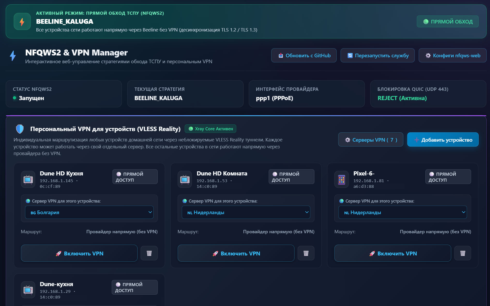
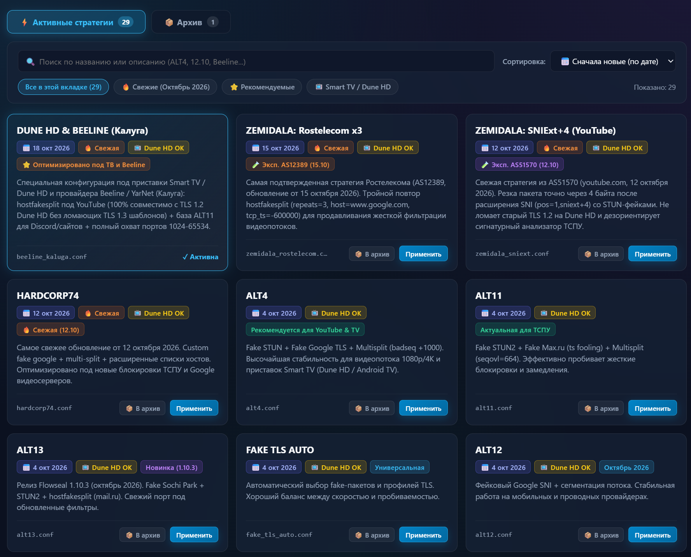
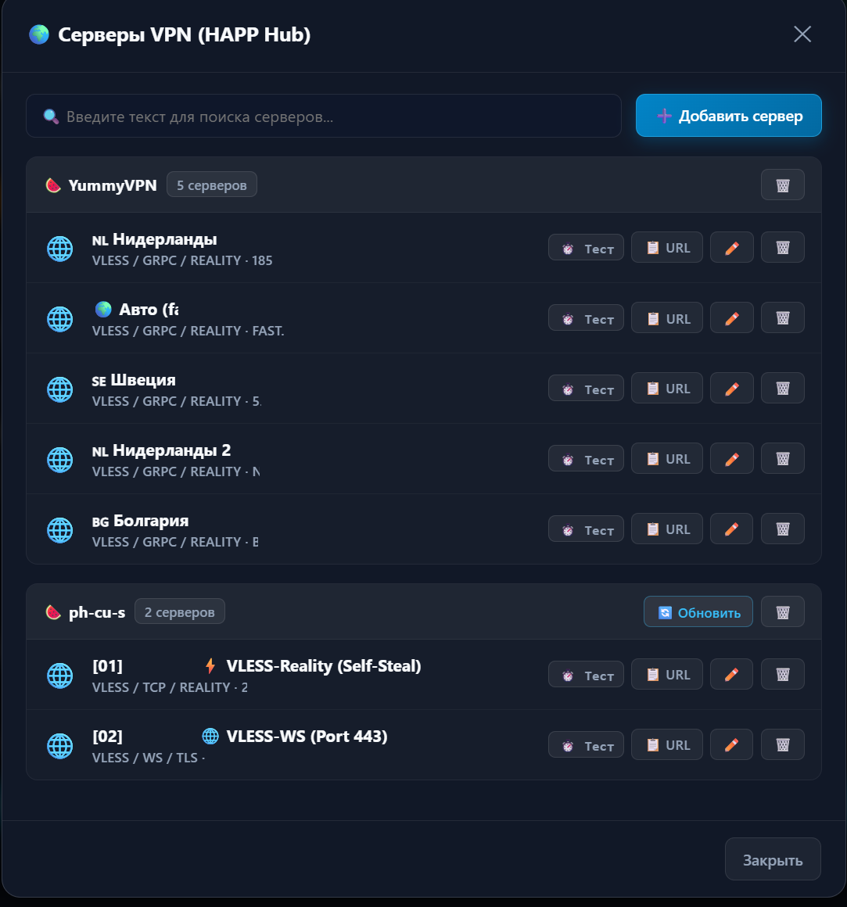
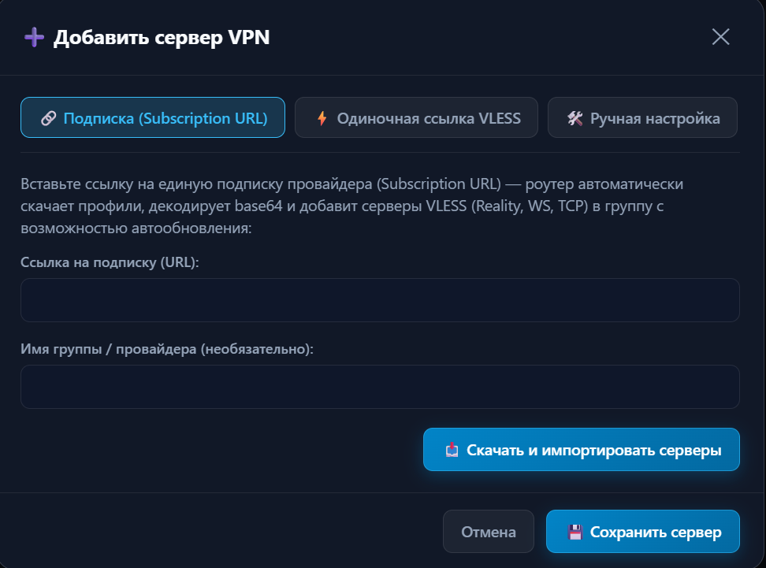

# Keenetic NFQWS2 & VPN Strategy Manager ⚡

Интерактивный веб-интерфейс (Web GUI) для роутеров **Keenetic** с установленной средой **Entware**. Позволяет в один клик переключать стратегии обхода ТСПУ (**NFQWS2 / Zapret**), управлять персональной маршрутизацией устройств домашней сети через **VPN (VLESS Reality / WebSocket / gRPC / Xray)**, проводить экспресс-диагностику доступности YouTube и Discord прямо из браузера, а также решает проблему зависания воспроизведения роликов через 1-2 минуты на приставках **Smart TV / Dune HD / Android TV**.

---

## 📸 Скриншоты интерфейса

### 1. Главная панель управления:
> Индикатор активного режима работы (NFQWS2 / VPN), статус службы, текущая стратегия, блок управления персональным VPN для домашних устройств и экспресс-тест соединений.


### 2. Каталог стратегий и система архивирования:
> Вкладки «Активные стратегии» и «Архив», даты релизов, бейджи совместимости (Dune HD / Smart TV), поиск на лету, фильтры и кнопка отправки стратегий в архив.


### 3. Менеджер серверов VPN (HAPP Hub):
> Группировка по провайдерам, экспресс-замер задержки (ping) с роутера, копирование VLESS URL, кнопка «Обновить подписку», редактирование и удаление серверов.


### 4. Добавление серверов VPN и импорт подписок:
> Три способа подключения: единая ссылка на подписку (Subscription URL) с Base64 декодированием, одиночная ссылка VLESS или ручная настройка параметров.


### 5. Интеграция в панель nfqws-web:
> Кнопка быстрого перехода в нижней панели стандартного интерфейса nfqws-web (порт 90).


---

## ✨ Ключевые возможности

### ⚡ 1. Интеллектуальный каталог стратегий NFQWS2
* **Переключение 29+ стратегий в один клик:** Смена стратегии и бесшовный перезапуск службы за 1 секунду прямо из браузера без подключения по SSH.
* **📦 Система архивирования стратегий:**
  * Две удобные вкладки: **«⚡ Активные стратегии»** и **«📦 Архив»**.
  * Неподходящие для вашего провайдера стратегии отправляются в архив одной кнопкой, не захламляя список.
  * Текущая активная стратегия защищена от случайного перемещения в архив.
* **Точные даты релизов и коммитов:** Каждая карточка снабжена датой актуальности (например, `📅 18 окт 2026`, `📅 12 окт 2026` для `HARDCORP74`, `ALT13`, `ALT11` и др.), помогая сразу выбирать самые свежие решения под текущие волны ТСПУ.
* **Умная сортировка и поиск:** «Сначала новые (по дате)», «Рекомендуемые», «По имени (А-Я)», живой поиск и фильтры `🔥 Свежие`, `⭐ Рекомендуемые`, `📺 Smart TV / Dune HD`.

### 🛡️ 2. Персональный VPN для устройств (VLESS Reality / Xray) в стиле HAPP
* **Универсальное добавление устройств локальной сети:**
  * Нажмите **«+ Добавить устройство»** — роутер покажет список всех зарегистрированных клиентов сети из таблиц DHCP и Hotspot Keenetic (Dune HD, Smart TV, смартфоны, ПК).
  * Возможность добавить любое устройство вручную по IPv4.
* **Индивидуальная маршрутизация:** Каждому устройству можно назначить свой независимый VPN-сервер. Например:
  * ТВ-приставка в спальне работает через сервер в Нидерландах.
  * Приставка в гостиной — через сервер в Швеции.
  * Остальные домашние устройства выходят в сеть напрямую через провайдера без VPN.
* **Менеджер серверов HAPP Hub:**
  * **Импорт единой подписки (Subscription URL):** вставьте ссылку подписки провайдера (формат Base64, как в HAPP/Hiddify/v2rayN) — роутер автоматически скачает профили, создаст группу и добавит серверы.
  * **Кнопка «🔄 Обновить подписку»:** обновление списка серверов провайдера в 1 клик без ручного ввода ключей.
  * **Импорт одиночной ссылки VLESS:** распознавание параметров Reality, WebSocket, gRPC, TCP, TLS.
  * **Замер пинга в реальном времени:** моментальный опрос сетевого отклика серверов с роутера (⚡ 50–70 ms).
  * **Копирование VLESS URL:** экспорт конфигурации любого сервера в один клик.
* **📱 Мобильная адаптация и понятная индикация статуса:**
  * Полноценная адаптивная верстка под экраны смартфонов (`@media max-width: 640px`).
  * Яркий изумрудный индикатор и пульсирующий бейдж `🟢 VPN ВКЛЮЧЕН` со статусом кнопки `🟢 VPN ВКЛЮЧЕН · Отключить`.
  * Контрастное состояние `⚪ ПРЯМОЙ ДОСТУП` с кнопкой `🚀 Включить VPN`.
  * Визуальные индикаторы прогресса переключения (`⏳ Включаем VPN...` / `⏳ Отключаем VPN...`) и антикэширование статуса в браузерах телефонов.


### 🚨 3. Реаниматор YouTube / Детектор зависших узлов (GGC Killer)
* **Решение проблемы «видео играет 1-2 минуты и зависает»:**
  * Локальные кэш-серверы Google Global Cache (GGC) у многих провайдеров РФ деградировали или блокируются ТСПУ: пинг до них идёт, но сокет HTTPS 443 висит по таймауту.
  * Модуль **«Реаниматор YouTube»** по нажатию одной кнопки анализирует активные соединения телевизора или ПК, выявляет зависший узел, мгновенно сбрасывает зависший сокет (`conntrack`) и блокирует мертвую подсеть с возвратом **TCP Reset (`REJECT --reject-with tcp-reset`)**.
  * Приложение YouTube моментально переключается на рабочие европейские CDN-серверы Google, и видео продолжается на полной скорости тарифа (100 Мбит/с) без перезагрузки приставки или роутера.
* **Интерактивное управление блокировками:** Просмотр активных заблокированных подсетей в виде бейджей, удаление и добавление в один клик с сохранением в правилах netfilter роутера.

### 🧪 4. Экспресс-тест соединений прямо с роутера
* Проверка рукопожатия **TLS 1.3** (ПК, современные браузеры, смартфоны).
* Проверка рукопожатия **TLS 1.2** (ТВ-приставки Dune HD, Smart TV, Android 7–9).
* Проверка доступности картинок превью YouTube (`i.ytimg.com`).
* Проверка веб-шлюза Discord (`discord.com`).

---

## 🚀 Быстрая установка (в 1 команду)

Подключитесь к роутеру по SSH (`ssh root@192.168.1.1 -p 222`) и выполните команду:

```bash
sh -c "$(curl -fsSL https://raw.githubusercontent.com/SaidAuita/keenetic-nfqws2-manager/main/install.sh)"
```

После завершения установки откройте в браузере:  
👉 **`http://192.168.1.1:90/menu.php`**

---

## 🛠️ Ручная установка (по шагам)

Если вы хотите установить файлы вручную:

1. **Скопируйте веб-интерфейс:**
   ```bash
   cp menu.php /opt/share/www/nfqws/menu.php
   chmod 644 /opt/share/www/nfqws/menu.php
   ```

2. **Скопируйте базу дат стратегий:**
   ```bash
   mkdir -p /opt/etc/nfqws-menu
   cp strategy_dates.json /opt/etc/nfqws-menu/strategy_dates.json
   chmod 644 /opt/etc/nfqws-menu/strategy_dates.json
   ```

3. **Скопируйте стратегию для Smart TV:**
   ```bash
   mkdir -p /opt/etc/nfqws-menu/strategies/nfqws2
   cp strategies/beeline_kaluga.conf /opt/etc/nfqws-menu/strategies/nfqws2/beeline_kaluga.conf
   ```

4. **Установите правило сброса мертвых кэшей GGC:**
   ```bash
   mkdir -p /opt/etc/ndm/netfilter.d
   cp 051-block-dead-ggc.sh /opt/etc/ndm/netfilter.d/051-block-dead-ggc.sh
   chmod +x /opt/etc/ndm/netfilter.d/051-block-dead-ggc.sh
   type=ip table=filter /opt/etc/ndm/netfilter.d/051-block-dead-ggc.sh
   ```

---

## 💡 Почему NFQWS2 эффективнее VPN на роутере?

Часто пользователи пытаются направить приставку целиком через тяжелый VPN на роутере, но сталкиваются с тем, что видео 1080p/4K заикается.

* Процессоры домашних роутеров (MIPS/ARM) не имеют специализированных аппаратных инструкций шифрования для клиентского VPN на высоких скоростях.
* При передаче тяжелого потока процессор роутера нагружается шифрованием до 100%, и скорость падает до **10–15 Мбит/с**.
* При работе через **NFQWS2** процессор нагружен на **0%**, так как шифрования нет — пакеты модифицируются только в момент установки соединения (ClientHello), а основной поток видео прокачивается через аппаратный чип ускорения NAT на полной скорости вашего интернет-тарифа (до 1 Гбит/с).
* Для тех же сервисов, которые заблокированы по IP и требуют VPN, используется встроенный модуль **Персональный VPN (VLESS Reality)** с точечной маршрутизацией только нужных устройств.

---

## 📁 Структура репозитория

```
├── menu.php                  # Полнофункциональный веб-интерфейс Strategy Manager & VPN Hub (без личных данных)
├── strategy_dates.json       # База метаданных: даты выхода коммитов и описания стратегий
├── install.sh                # Установщик в 1 клик для Keenetic Entware
├── 051-block-dead-ggc.sh     # Скрипт netfilter для сброса зависших серверов GGC
├── strategies/
│   └── beeline_kaluga.conf   # Оптимизированная стратегия для Smart TV (TLS 1.2) и региональных провайдеров
└── images/
    ├── manager_gui_01.png    # Скриншот: Главная панель управления, GGC Killer и статус VPN
    ├── manager_gui_02.png    # Скриншот: Каталог стратегий с вкладками «Активные» и «Архив»
    ├── manager_gui_03.png    # Скриншот: Менеджер серверов VPN (HAPP Hub), пинг и группы
    ├── manager_gui_04.png    # Скриншот: Окно добавления серверов и импорта подписки
    └── sm_button.png         # Скриншот: Кнопка перехода в стандартном интерфейсе nfqws-web
```

---

## 🤝 Благодарности
* **Flowseal / Nare51** — за проект `nfqws-menu` и коллекцию стратегий.
* **bol-van** — за создание легендарного `zapret` и утилиты `nfqws`.
* **zemidala** — за актуализацию стратегий против свежих волн ТСПУ.
* Сообществу **4PDA** и пользователям роутеров Keenetic.
